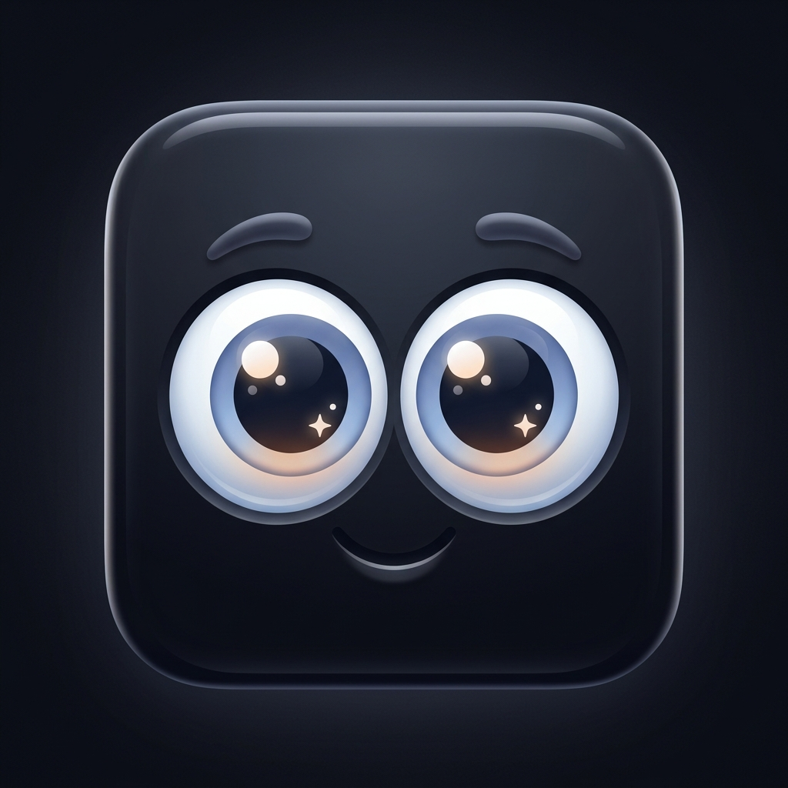

# 👁️ Eye Tracker Studio

<div align="center">



**A 60 FPS AI-Powered Gaze Tracking Engine, Interactive Cursor FX & OS Desktop Companion**

[](https://www.typescriptlang.org/)
[](https://react.dev/)
[](https://ai.google.dev/edge/mediapipe/solutions/vision/face_landmarker)
[](https://tailwindcss.com/)
[](https://www.electronjs.org/)

</div>

---

## ✨ Features Overview

Eye Tracker Studio turns your cursor and camera into a high-performance 60 FPS interactive companion. Designed for presentations, gaming, content creation, and accessibility.

```
       🎯 Cursor / Webcam Gaze Tracking
               │
      ┌────────┴────────┐
      ▼                 ▼
✨ Cute Eye Engine   🎮 Interactive FX & Tools
- Organic Blinking   - Laser Reticle
- Curved Eyelids     - Presenter Spotlight
- 7+ Eye Themes      - Particle Sprites & Trails
- Double Catchlight  - Odometer & AI Voice
```

---

## 🚀 Active Feature Modules (Live in App)

### 1. 🎯 AI Webcam Iris Accuracy & Blink Detection
- **MediaPipe 468-Point Face Mesh:** Real-time sub-millimeter iris coordinate tracking via local webcam.
- **Smart Smoothing Filter:** Low-pass exponential smoothing to eliminate camera jitter while preserving fast saccadic gaze movements.
- **Real-time Blink & Wink Detection:** Detects single-eye winks and dual-eye blinks from video frames, triggering matching eyelid closures in the canvas.

---

### 2. 💖 Cute Eye Behaviors & Dynamic Expressions
- **Organic Eyelids & Automatic Blinking:** Natural periodic blinking cycle (2.5s–4.8s) with realistic Bezier curved eyelids and eyelash contours.
- **Double Blinks & Playful Expressions:** Occasional double-blinks and wink responses on fast cursor movements or mouse clicks.
- **Expressive States:**
  - **Sleepy Idle Mode:** Eyes droop gently when no motion is detected for >25 seconds.
  - **Dizzy Spin Mode:** Pupils spin in dizzy circles during rapid mouse flick movements (>1200 px/s).
  - **Surprised Dilated Pupils:** Pupils dilate when rapid mouse clicks occur.

---

### 3. 🎨 Custom Eye Themes & Visual Styles
- ✨ **Cute Sparkle (Default):** Anime-style large pupils with double glossy catchlight sparkles and soft pink blush highlights (`#f472b6`).
- 👁️ **Natural:** Classic human iris with gradient depth and soft lighting reflections.
- ⚡ **Cyberpunk:** Neon cyan/magenta HUD rings, rotating target arcs, and crosshair overlays.
- 🐱 **Cat Slit:** Golden amber sclera with dynamic vertical cat pupil slits.
- 👀 **Googly:** Spring-damper physics simulation for bouncy wobbly googly eyes.
- 👾 **Pixel:** 8-bit retro arcade pixelated eye blocks.
- 🤖 **Robot:** Metallic dark bezel with glowing red LED core.

---

### 4. 🎮 Interactive FX, Tools & Accessibility
- 🎯 **Laser Reticle Mode:** High-precision red targeting reticle with futuristic HUD crosshairs.
- 💡 **Presenter Spotlight Mode:** Darkens the rest of your display while focusing a bright spotlight around your active cursor area.
- ✨ **Particle FX & Trails:** Glowing cursor particle trails with custom sprite shapes (Stars, Hearts, Bubbles, Neon Dust).
- 🔊 **Web Audio Synthesizer:** Real-time procedural audio pop, laser beam, and power-up sound effects.
- 🎙️ **AI Voice Command Recognition:** Voice-control themes and features (say `"laser"`, `"cyberpunk"`, `"game"`, `"trail"`).
- 📊 **Odometer Analytics:** Tracks distance traveled in meters, total clicks, and real-time mouse speed.
- 🎯 **Gaze Target Shooter Mini-Game:** Built-in interactive target popping game to test your gaze and cursor speed!

---

## 🔮 Master Feature & AI Roadmap

### 🤖 Multimodal Vision AI ("What Are You Looking At?")
- [ ] **AI Gaze Scene Explainer:** Hold your gaze on any code block, image, or chart on screen to get an instant AI vision summary!
- [ ] **AI Reading Assistant:** Highlights and defines complex terms as your gaze scans text.

### 💖 Cute Emotion & Expression Engine
- [ ] **Happy / Smiling Eyes (`^ ^`):** Eyes squint into cute curved arcs when clicking or moving in circles.
- [ ] **Love / Heart Pupil Mode (`💖`):** Pupils morph into glowing pulsing hearts on double-click or webcam eye contact.
- [ ] **Animated Eyebrows:** Expressive mini eyebrows for surprised, focused, and sleepy moods.
- [ ] **Gaze Eye-Contact Reaction:** Eyes blush and smile back when AI camera detects direct eye contact!

### 🎨 Creative Eye Themes & Custom Designer
- [ ] **Anime Heart Eyes:** Pulsing pink heart pupils with star catchlights.
- [ ] **Dragon / Reptile Eyes:** Glowing golden scales with dynamic pupil slits.
- [ ] **Cosmic Galaxy Eyes:** Rotating spiral galaxy iris with floating stardust.
- [ ] **Matrix Code Rain Eyes:** Falling green matrix numbers inside the pupil.
- [ ] **Fiery Flame Eyes:** Animated flickering flame aura around the iris.
- [ ] **In-App Custom Eye Studio:** Customizer modal to tweak pupil color, iris gradient, and glow intensity.

### 🎵 Musical Eye Theremin & Audio Visualizer
- [ ] **Musical Eye Theremin:** Play musical notes with your gaze (X-axis controls pitch, Y-axis controls vibrato).
- [ ] **Music Reactive Pupil Pulse:** Pupils pulse dynamically to the bassline of playing music!

### 🌈 Mood-Adaptive Trails & Black Hole Physics
- [ ] **Speed-Adaptive Particle Trails:** Trail colors shift from cyan to fiery orange based on cursor speed.
- [ ] **Gravity Well Black Hole FX:** Click creates a mini black hole pulling screen particles inward!

### 📸 Gaze Screen Recorder & Multilingual Voice
- [ ] **Gaze Overlay GIF/MP4 Recorder:** Record quick screen clips with animated eyes overlay for Twitter/Discord.
- [ ] **Multilingual Voice Commands:** Support voice commands in English, Spanish, Japanese, French, German, and Hindi!

### 🧠 Emotion AI & Mood Synchronization
- [ ] **AI Mood & Facial Expression Sync:** Real-time facial sentiment analysis via webcam so the eyes mirror your exact mood (*Happy, Surprised, Confused, Focused, Tired*).
- [ ] **AI Drowsiness & Yawn Safety Guard:** Detects eye strain, frequent blinks, or yawns to suggest 20-second eye relaxation breaks.

### 🎯 AI Intent Pointer & Smart Gestures
- [ ] **AI Target Snap-to-Button:** Predicts intended click targets from gaze velocity and snaps the reticle smoothly to buttons.
- [ ] **AI Camera Gestures:** Head Nod (Confirm), Head Shake (Cancel), Smile (Heart particles), Left/Right Winks.

### 🧠 Subconscious Pupillometry & Attention Analysis
- [ ] **Task-Evoked Pupil Dilations:** Measures cognitive load & micro-frustration in real-time to adjust UI legibility.
- [ ] **Foveal Speed Reading Mode:** Stream 1,000 WPM text directly into your gaze focus zone.

### ⚡ Micro-Saccade Telepathy & Hands-Free Tools
- [ ] **Predictive Target Trajectory:** Detects 10ms micro-saccades before hand movement to snap cursor pre-emptively.
- [ ] **Gaze Dwell-Click:** Hands-free auto-click when holding gaze on a target for 1.5 seconds.

### 🎭 Living AI Digital Companion (Autonomous Soul Engine)
- [ ] **Autonomous Behavior States:** Eyes explore screen, inspect open windows, and chase particles independently when idle.
- [ ] **Multimodal "Look & Command":** Look at *any* screen region and say *"Explain"*, *"Translate"*, or *"Summarize"*.

### 🗣️ AI Voice & Audio Companion
- [ ] **Interactive AI Voice Personality:** Give the animated eyes a voice assistant persona that speaks back when commanded!
- [ ] **Adaptive Generative Audio:** Background ambient music tempo adapts to your mouse speed and focus state.

### 🛡️ Continuous Biometric Iris Guard & Security Shield
- [ ] **Passive Eye-Reflection Security:** Continuous ocular reflection authentication; instant screen lock if looking away.
- [ ] **Peeping Guard:** Automatically blurs sensitive windows when an unknown face walks behind you.

### 🌐 Spatial 3D Lighting & Multi-Monitor Companion
- [ ] **Webcam Ambient Relighting:** Eyes cast dynamic 3D shadows matching room lighting & desktop window colors.
- [ ] **Multi-Display Seamless Jump:** Eyes teleport smoothly across multi-monitor setups.

### 🎥 Twitch / YouTube Streamer Overlay Suite
- [ ] **Live Gaze Heatmap Broadcast:** Overlay real-time gaze targeting on live game streams.
- [ ] **Twitch Chat Emoji Reaction System:** Eyes react dynamically to live chat emotes (`Pog`, `LUL`, `❤️`).

### 🎯 Presentation, Health & Productivity Tools
- [ ] **Reading Ruler:** Highlighted focus line under the text line your gaze is reading.
- [ ] **20-20-20 Eye Rest Reminder:** Cute eye-closing animation every 20 minutes to prevent eye strain.

---

## 🛠️ Quick Start (Development)

```bash
# Clone repository
git clone https://github.com/ripudamank2/eye_tracking_pain.git
cd eye_tracking_pain

# Install dependencies
npm install

# Run local development server (60 FPS Web App)
npm run dev
```

Open `http://localhost:5173/` in your browser.

---

## ⌨️ Desktop Controls & Interactions

| Interaction | Action |
| :--- | :--- |
| **Mouse Move / Webcam Gaze** | Eyes follow target with spring physics |
| **Right-Click Anywhere** | Open Floating Studio Controls Context Menu |
| **Left Click** | Trigger click burst particles & sound FX |
| **Rapid Clicks** | Dilate pupils (Surprised state) |
| **Fast Mouse Flick** | Dizzy pupil spin animation |
| **Idle (>25s)** | Sleepy eyelids droop |

---

## 🤝 Contributing & License

Distributed under the **MIT License**. Created with ❤️ by the VoltAI Team.
